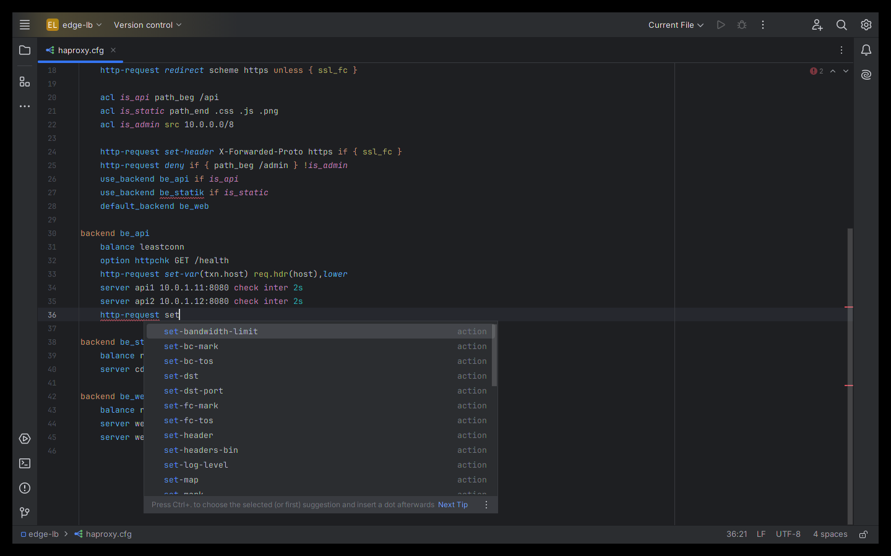
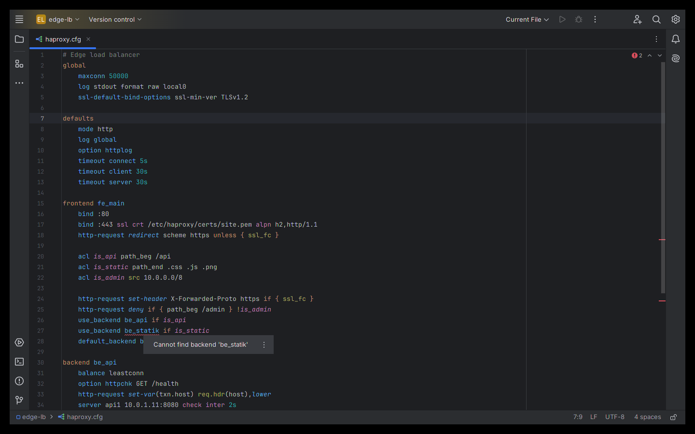
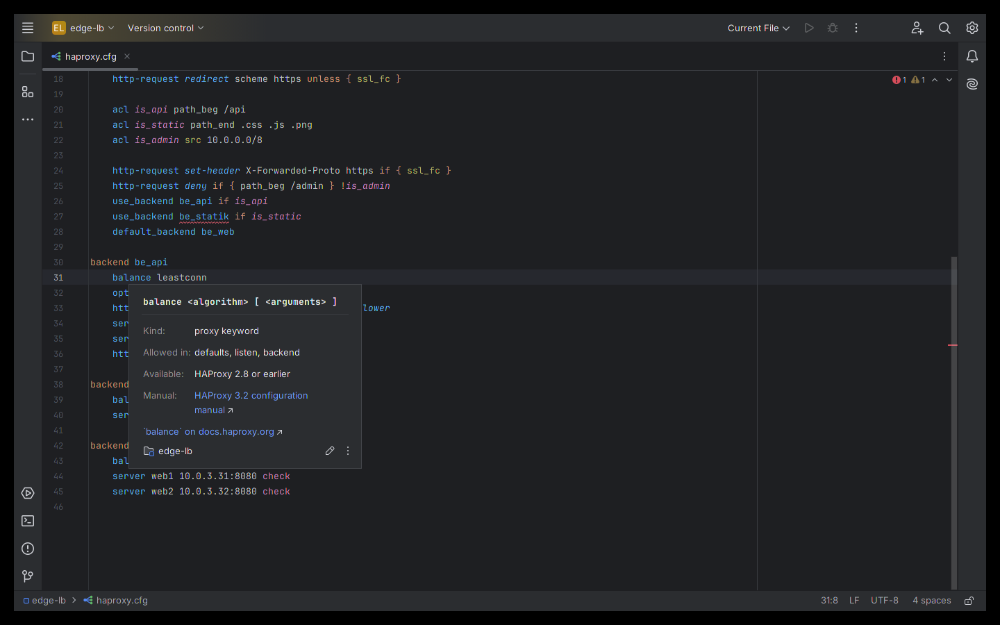

# HAProxy Config — JetBrains IDE plugin

Language support for **HAProxy configuration files** (`haproxy.cfg`) in IntelliJ IDEA, PyCharm, GoLand, WebStorm,
PhpStorm, Rider, CLion, RubyMine, DataGrip and every other JetBrains IDE (2024.3 and newer).

Install: *Settings → Plugins → Marketplace → search "HAProxy Config"*.

## Features
- Syntax highlighting for sections, directives, actions, ACLs, conditions, sample fetches, converters,
  `%[...]` expressions and `${ENV}` variables (colors configurable under *Settings → Editor → Color Scheme → HAProxy*)
- Context-aware completion: keywords valid in the current section, `http-request`/`tcp-request` actions per rule set,
  bind and server options, sample fetches, converters, backend and ACL names
- Go to declaration, find usages and rename for backends, ACLs, servers, caches, resolvers, peers, http-errors and
  defaults sections
- Inspections: unknown or misplaced keywords, invalid actions for a rule set, undefined backends/ACLs, duplicate proxy or
  server names, unused ACLs, deprecated keywords
- Quick documentation (Ctrl+Q / F1) with syntax, allowed sections, version info and a link to the official manual
- **Target version check**: pick the HAProxy version your servers run (*Settings | Languages & Frameworks | HAProxy*);
  sections, keywords, actions, bind/server options, fetches and converters newer than that are flagged, and completion
  only offers what that version supports
- **Reformat Code**: section bodies indented consistently, trailing whitespace removed; hand-aligned arguments are kept
- Structure view, section folding, `#` commenting

Keyword data is generated from the official HAProxy configuration manuals 2.6, 2.8, 3.0, 3.1, 3.2, 3.3, 3.4 and the
current development manual (3.5-dev). It was checked against the ~370 configurations in HAProxy's own regression test suite.

| Inspections | Quick documentation |
|---|---|
|  |  |

## File detection
`haproxy.cfg`, `*haproxy*.cfg`, `*haproxy*.conf` and `*.haproxy` are recognised automatically, as are extension-less
files with HAProxy content. For other names (e.g. `conf.d/10-web.cfg`) use *Override File Type → HAProxy* or add a
pattern under *Settings → Editor → File Types → HAProxy*.

## More Klardaten plugins

- [VCL Language Tools](https://github.com/klardaten-dev/vcl-language-tools) — Varnish and Fastly VCL: completion, cross-file navigation, 8 inspections
- [Puppet Manifest Tools](https://github.com/klardaten-dev/puppet-manifest-tools) — Puppet manifests: Puppet 8 legacy-fact fixer, attribute checks, completion
- [PromQL and Prometheus Rules](https://github.com/klardaten-dev/promql-tools) — PromQL inside .promql and Prometheus rule files, checked like Prometheus itself
- [DNS Zone File Tools](https://github.com/klardaten-dev/dns-zone-tools) — BIND-style zone files: 70+ record types, trailing-dot, CNAME, SPF/DMARC checks

## Source code
The plugin is closed source (free to use under the EULA); this repository hosts its documentation, license and issue tracker. The source code is not public.

## Support
Please open an [issue](../../issues) for bugs and feature requests. Include your IDE version and, if possible, a minimal
config snippet that shows the problem (remove secrets and internal host names first).

## Privacy
The plugin works fully offline. It collects no data and sends nothing anywhere. See [PRIVACY.md](PRIVACY.md).

## License
Free to use under the [End User License Agreement](EULA.md).

---
Independent project, not affiliated with or endorsed by HAProxy Technologies. HAProxy is a trademark of its respective
owner. JetBrains and IntelliJ are trademarks of JetBrains s.r.o.
